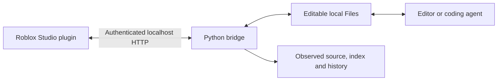

# StudioWorkflow

**Work on Roblox scripts through local files. Keep source searches and edits out of the MCP loop.**

[](https://github.com/TrapstarKS/StudioWorkflow/actions/workflows/test.yml)

[Português](docs/README.pt-BR.md) · [Agent skill](studioworkflow/skill/SKILL.md) · [Commands & recovery](docs/workflow.md) · [MIT license](LICENSE)

StudioWorkflow connects a local Studio plugin to a small Python service. Scripts become ordinary `.luau` files: your editor or coding agent searches, reads and edits them locally, while the bridge synchronizes existing scripts and checks for concurrent changes.

The background bridge makes **no model calls and no MCP calls**. Your agent still spends tokens on the snippets it reads and the changes it writes; bounded search results and line ranges let you control that context. No savings percentage is assumed.



## What you get

- Two-way source synchronization, including changes received from Team Create.
- Search of **current local files**, including held and unsent edits; an optional indexed search of the last observed Studio source.
- Bounded, numbered source reads instead of whole-script dumps.
- Debounced saves, optional checkout holds, three-way merges and source/instance checks before writes.
- Separate state for each place, reconnect recovery, chunked large-script transport and source history.
- A generated local plugin, optional login startup, diagnostics and project-scoped instructions for Codex or Claude Code.
- A Python standard-library runtime. No Roblox API key, cloud service, MCP server, Lune or Rojo required to use it.

It handles script sources and a small amount of script metadata. Use Studio or other tools for assets, terrain, instance creation/deletion/rename, hierarchy and runtime tests. Creating or deleting a file on disk does not create or delete a Studio instance. The bridge never publishes a place.

## Let your agent install it

Paste this into your coding agent, filling in the paths and real IDs:

```text
Install StudioWorkflow from https://github.com/TrapstarKS/StudioWorkflow.
Read its README and use an isolated Python virtual environment.
Tool directory: <stable local folder>
Game workspace: <stable local folder for this game>
Places: lobby=<PLACE_ID>, arena=<PLACE_ID>
Install the project skill for <codex|claude|both> and enable login startup.
Use the documented CLI, preserve existing project instructions, and run doctor.
Tell me which Studio restart/permission step remains. Do not publish the game.
```

## Manual installation

You need **Roblox Studio, Python 3.11+ and Git**, on macOS or Windows. Install Python from [python.org](https://www.python.org/downloads/) and Git from [git-scm.com](https://git-scm.com/downloads).

Keep the tool checkout and your game workspace in stable local folders. The workspace holds private source, configuration and history; use a separate workspace for each game. Avoid cloud-synced folders and sharing a live workspace between computers.

### macOS

```sh
git clone https://github.com/TrapstarKS/StudioWorkflow.git
cd StudioWorkflow
python3 -m venv .venv
.venv/bin/python -m pip install .
.venv/bin/python -m studioworkflow --root "$HOME/Roblox/MyGame" init --place lobby=123456 --agent both --startup
```

### Windows — PowerShell

```powershell
git clone https://github.com/TrapstarKS/StudioWorkflow.git
cd StudioWorkflow
py -3 -m venv .venv
.\.venv\Scripts\python.exe -m pip install .
.\.venv\Scripts\python.exe -m studioworkflow --root "$env:USERPROFILE\Roblox\MyGame" init --place lobby=123456 --agent both --startup
```

Replace `123456` with your **Place ID**, not the Universe ID. Add another place with `--place arena=987654`. Aliases are safe lowercase names such as `lobby`, `arena` or `trade-hub`.

To find the ID, open that place in Studio and run `print(game.PlaceId)` in the Command Bar. If it returns `0`, open an existing place with an assigned Place ID; unsaved places are not supported by this mapping.

`--agent both` installs only StudioWorkflow's own skill and a small marked instruction block into the game workspace. Select `codex`, `claude`, or omit it for manual use. Existing instructions are preserved; unrelated skills are never replaced. No game-specific skills are bundled.

`--startup` starts the supervisor and installs login startup. Omit it to run the bridge in a terminal:

```sh
studioworkflow --root /path/to/MyGame run
```

For the short `studioworkflow` commands in this README, activate the virtual environment or use the same environment's Python followed by `-m studioworkflow`, as above. Setup records the Python executable and invocation directory so an installed agent skill can find the correct environment without guessing PATH.

Without `--place`, a terminal setup prompts for aliases and IDs. Non-interactive agents must supply `--place`. A second `init` keeps the current IDs, installation identity, key and settings; it refreshes the plugin and any explicitly selected instructions. A workspace cannot silently be reassigned to other places.

### Finish in Studio

1. Save your work, close and reopen Studio so it loads the generated local plugin.
2. Open a configured place in Edit mode. Accept the plugin's localhost and script-editing permissions if Studio prompts.
3. Run `studioworkflow --root /path/to/MyGame doctor`. The opened place should reach `ready`; unopened places can remain `offline`.
4. Your scripts appear in `studio/lobby/Files/`. Edit an existing script there and save it.

If the plugin is missing, use Studio's **Plugins Folder** action and re-run `init --plugins-dir /actual/plugin/folder`. Roblox documents [local plugins](https://create.roblox.com/docs/studio/plugins), [plugin localhost permissions](https://create.roblox.com/docs/cloud-services/http-service#use-in-plugins), and [editor-aware source updates](https://create.roblox.com/docs/reference/engine/classes/ScriptEditorService#UpdateSourceAsync).

## Daily use

Run from the game workspace, or put `--root /path/to/MyGame` **before** the subcommand.

```sh
studioworkflow search "Inventory" --place lobby --limit 5
studioworkflow read --place lobby --path ReplicatedStorage/Inventory.luau --start 20 --lines 40
```

Search returns short excerpts, editable file paths and compact Studio freshness. The default scans registered scripts in current `Files/`; `--observed` searches Studio's last observed source index. Exact strings and regular expressions can also be searched with `rg` in `Files/`. Source reads cap their output and report truncation.

For a short edit, read the current file, patch it, and save. Automatic sync sends it after the debounce; a confirmation comes from an operation result or observed source, not merely from a successful file save.

For an edit with several saves or another person working on the same script, hold the base **before reading**:

```sh
studioworkflow checkout --place lobby --path ReplicatedStorage/Inventory.luau
# Read and edit studio/lobby/Files/ReplicatedStorage/Inventory.luau.
studioworkflow apply --place lobby --path ReplicatedStorage/Inventory.luau
```

`checkout` suppresses automatic sends and protects the file from refresh. `apply` compares the base and waits briefly for the result. An interrupted or uncertain delivery needs investigation; the bridge does not blindly overwrite the Studio copy.

## Configuration

`studio-workflow.json` belongs to the **game workspace**, not the installed package. Setup generates the installation ID and a separate private key. Re-run `init` to change settings and refresh the plugin, then restart the bridge and Studio if the port changed.

| Setting | Default | Purpose |
| --- | --- | --- |
| `port` | Available local port | Loopback-only HTTP endpoint; `init --port 8647` sets one explicitly. |
| `auto_sync` | `true` | `init --no-auto-sync` requires explicit `apply` for outbound edits. |
| `sync_debounce_seconds` | `1.5` | `init --debounce 2` waits for saves to settle. |
| `heartbeat_timeout_seconds` | `20` | A stale observer blocks writes; allowed range is 5–300 seconds. |
| `places` | Supplied at setup | Alias → Place ID, isolated per workspace. |
| `minimum_observer_protocol` | `3` | Blocks writes from older plugins; setup restores the supported version. |

`--plugins-dir` overrides plugin discovery. For example, configure without automatic sending or login startup:

```sh
studioworkflow --root /path/to/MyGame init --place lobby=123456 --no-auto-sync --debounce 2 --plugins-dir /path/to/Plugins
```

The generated plugin has a unique name per installation. Two games can use separate workspaces, ports and plugins. Keep one bridge responsible for a given place on each computer; two observers connected to the same workspace/place are rejected.

## Conflicts and recovery

Use `doctor` for installation/connectivity and `status` or `changes` for source issues. No agent polling loop is needed.

| State | Meaning / next step |
| --- | --- |
| `ready` | Complete inventory, fresh Edit-mode observer. Check per-file issues before applying. |
| `offline` | Open the place, check service/plugin permissions and wait for reconnect. |
| `refreshing` | Initial or replacement inventory is in progress; sends wait. |
| `play` | Outbound source writes are paused. Return to Edit mode. |
| `restart_required` | Re-run `init` after updating the tool, then reopen Studio. |
| File conflict or uncertain operation | Inspect `changes` / `operation`, compare both versions, then use the recovery workflow. |

`rebase` proposes a three-way merge and holds a clean result for review. Overlapping edits preserve the base, local and Studio versions in a conflict record. See [commands and recovery](docs/workflow.md) for the exact flow, history export and pause/resume behavior.

Logs are in `.studio-workflow/serve.log`, `supervisor.log`, `launcher.log` and `launcher-error.log`. Supervisor logs rotate; source history grows with edits. Keep private logs and history out of bug reports.

## Update or uninstall

Stop the supervisor before updating. With login startup enabled, `uninstall` removes that startup entry and the local plugin while preserving your source, configuration, key and history. It is safe to reinstall into the same workspace afterward.

```sh
studioworkflow --root /path/to/MyGame uninstall
# In the tool checkout:
git pull --ff-only
python -m pip install .
studioworkflow --root /path/to/MyGame init --agent both --startup
```

Use the same Python environment for installation and update. Reopen Studio to unload the old plugin and load the replacement. `stop` requests a running supervisor to exit; it does not remove a login service, which may restart it.

Uninstall removes only the owned plugin and startup launcher. It preserves source/history and the project skill/instruction block; remove those marked entries manually if you no longer use the workflow. Modified or unrelated installed files are not silently overwritten or deleted.

## Boundaries

- This is a source bridge, not a complete DataModel exporter, game backup or Rojo project generator.
- The Studio session must receive a Team Create change before the bridge can observe it. Reconnect refreshes the complete inventory. Private Drafts remain governed by Roblox's own workflow.
- Duplicate instance names are marked ambiguous and cannot be written through the bridge. Case-insensitive file collisions stop activation. Reserved Windows names and trailing spaces are percent-encoded.
- Script records are limited to **16 MB of UTF-8 JSON**, with at most 100 inbound chunks; outbound operations allow at most 1,000 chunks of 32,000 characters. Escaping and metadata count toward record size. Oversized records stop inventory with a diagnostic; split or edit those scripts in Studio.
- Readiness and Studio observations are point-in-time information. A save alone is not proof of delivery; use operation results when confirmation matters.
- Automatic sync is for trusted local files. Treat a coding agent's save as a potential Studio edit; use checkout or disable auto-sync when reviewing intermediate work.
- Runtime behavior is covered by HTTP integration tests and mocked Luau plugin tests. Actual Studio permissions, Windows login integration and Team Create behavior still need testing on the destination machine.

## Development

```sh
python -m pip install .
python -m unittest discover -s tests -v
```

[Lune](https://github.com/lune-org/lune) is optional for development: when available, tests also execute the plugin against mocked Roblox services, including source races, reconnects, Play barriers and large operations. CI runs Python tests on macOS, Windows and Linux; Linux is a test environment, not a Roblox Studio target.

See [CONTRIBUTING.md](CONTRIBUTING.md) for architecture, test scope and release checks.
